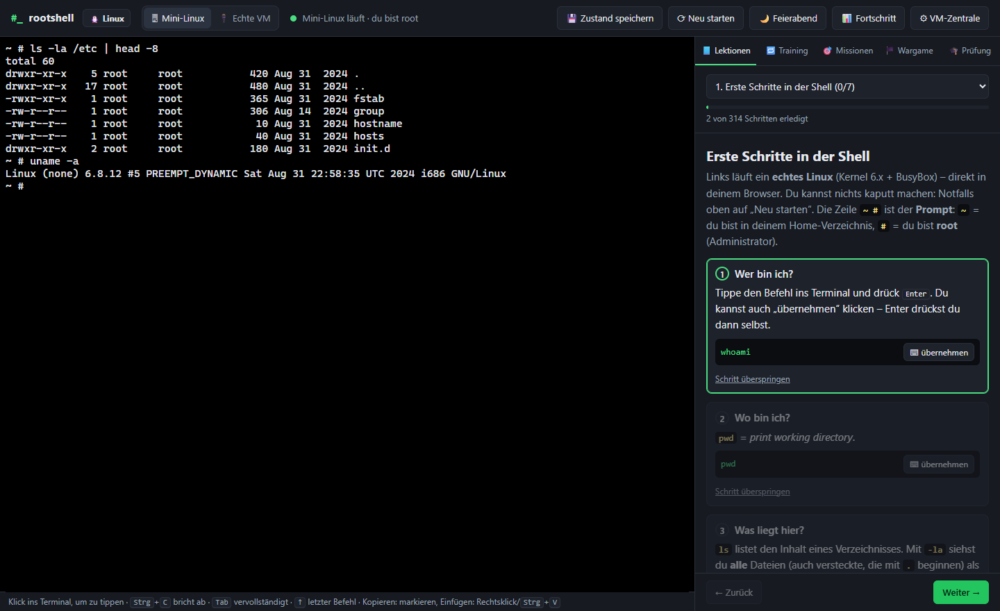
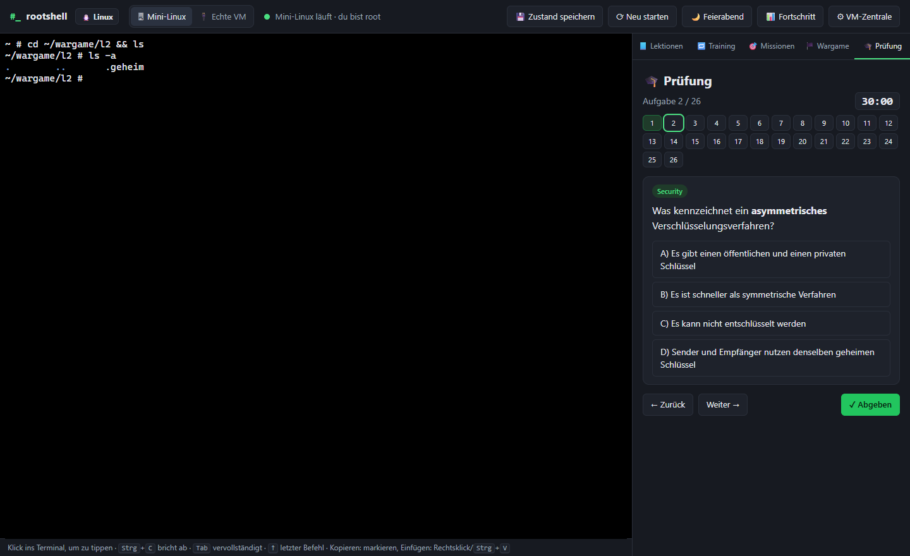
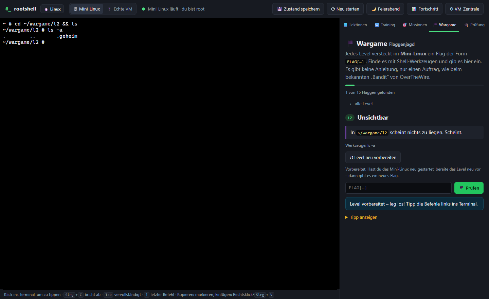
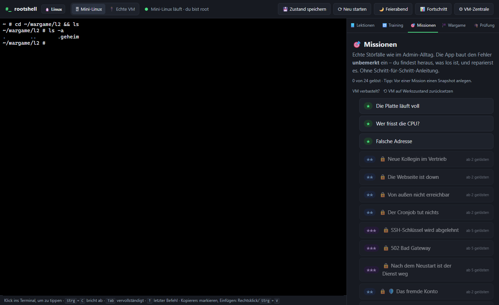

# #_ rootshell

**Linux- und Windows-Administration lernen – an echten Systemen.**
Links eine echte Shell, rechts das Tutorial. Jeder Schritt wird automatisch abgehakt, sobald du den richtigen Befehl eintippst. Dazu kommen ein Lernkartei-Training mit steigender Schwierigkeit und Störfall-Missionen: Die App baut unbemerkt einen Fehler ein, du findest und behebst ihn, die App prüft das Ergebnis.

Gebaut für Azubis und Umschüler **Fachinformatiker Systemintegration (FISI)**, aber für alle nützlich, die Admin-Handwerk üben wollen. Alle Inhalte sind auf Deutsch.

**▶ Online-Demo folgt in Kürze** – Mini-Linux, SQL-Krimis, Lektionen, Training, Wargame und Prüfung laufen dann direkt im Browser, ohne Installation. Für die VMs, PowerShell und die Windows-Sandbox installierst du rootshell lokal.



| Kurs | Umgebung | Inhalt |
|---|---|---|
| 🐧 **Linux** | Mini-Linux und SQL-Konsole im Browser + Übungs-VM + Server-VM | Shell-Grundlagen bis LEMP, DNS, DHCP, Docker, Selbst-Hosting, **Bash-Skripte**, **IT-Security (Blue Team)**, **Netzwerk & Subnetting**, **Git & Docker**, **Datenbanken mit SQL-Krimi** – 65 Lektionen, 28 Missionen |
| 🪟 **Windows · PowerShell** | PowerShell 7 in der Übungs-VM + echtes Windows in der Windows-Sandbox | Pipeline, CSV/JSON, Dienste, Benutzer, NTFS, Registry, Firewall, geplante Aufgaben, **PowerShell-Skripte** – 25 Lektionen, 10 Missionen |
| 🎓 **Prüfung** | Browser | Prüfungssimulation im IHK-Stil mit Note, Themen üben, endloser Subnetting-Trainer |
| 🏴 **Wargame** | Mini-Linux im Browser | 15 Level Flaggenjagd im Stil von OverTheWire „Bandit“ |

Nichts davon verändert deinen PC: Die VMs und die Sandbox laufen abgeschottet, die Übungs-VM ist eine Wegwerf-Umgebung.

## Der Lernpfad: erst lernen, dann üben, dann anwenden

Jedes Thema führt dich in vier Stationen vom Verstehen zum Können. Eine Leiste oben in der Lektion zeigt, wo du stehst, und führt zur nächsten Station.

| Station | Wo | Was |
|---|---|---|
| **① Lernen** | Browser (Mini-Linux oder SQL-Konsole) | Grundlagen sofort ausprobieren, ohne Installation – auch in der Online-Demo |
| **② Üben** | 🧪 **Übungs-VM** (Wegwerf) | Echte Werkzeuge an echtem Ubuntu. „Übung vorbereiten“ setzt die VM vorher zurück und richtet ein, was die Übung braucht – hier darf alles kaputtgehen |
| **③ Anwenden** | 🖥 **Server-VM** (bleibt) bzw. echtes Windows | Echte Dienste Schritt für Schritt von Hand einrichten: WordPress, Gitea, Nextcloud, Samba, DNS … – dein eigener Server |
| **④ Störfall** | 🧪 Übungs-VM bzw. Windows-Sandbox | Ein Fehler wird unbemerkt eingebaut, du findest und behebst ihn ohne Anleitung |

| Thema | ① | ② | ③ | ④ |
|---|---|---|---|---|
| Linux-Grundlagen & Dienste | 9 | 4 | 10 | 8 |
| Bash-Skripte | 1 | 5 | 1 | 3 |
| Netzwerk | 1 | 5 | – | 3 |
| IT-Security | 1 | 3 | 4 | 7 |
| Git, Docker & Selbst hosten | 1 | 4 | 4 | 3 |
| Datenbanken | 3 | 1 | 6 | 4 |
| PowerShell & Windows-Verwaltung | – | 11 | 8 (Sandbox) | 8 |
| PowerShell-Skripte | – | 6 | – | 2 |

## Installation

**Voraussetzungen**

| | Wofür | Pflicht? |
|---|---|---|
| Windows 10/11 | Host | ja |
| [Node.js](https://nodejs.org) (LTS) | lokaler Server der App | ja |
| Windows **Pro/Enterprise/Education** mit Hyper-V + [Multipass](https://multipass.run) | Übungs-VM und Server-VM (Ubuntu) | für ② bis ④ – die App prüft und installiert das auf Knopfdruck |
| Windows-Feature **Windows-Sandbox** | echtes Windows für die Windows-Lektionen | nur für den Sandbox-Teil |
| ca. 8 GB RAM | Übungs-VM 1 GB, Server-VM 2 GB, Sandbox 3 GB – es läuft immer nur eine VM | empfohlen |

Mini-Linux, SQL-Konsole, Prüfung und Wargame laufen ohne VM. Die VM-Zentrale zeigt, wie viel Arbeitsspeicher gerade frei ist, und warnt, bevor eine VM nicht starten kann.

**Herunterladen und starten**

1. Repository herunterladen: grüner Knopf **Code → Download ZIP** und entpacken, oder
   ```bash
   git clone https://github.com/oemer-isbacar/rootshell.git
   ```
2. Im Ordner **`start.bat`** doppelklicken. Beim ersten Mal werden die Abhängigkeiten installiert (`npm install`).
3. Die App öffnet sich im Browser unter http://localhost:8086. Das schwarze Server-Fenster offen lassen, solange du lernst.

Beim ersten Start zeigt ein **🩺 Systemcheck**, was eingerichtet ist und was noch fehlt (Hyper-V, Multipass, VM, Windows-Sandbox) – und welche Teile du damit schon nutzen kannst. Die VM legst du über **⚙ VM-Zentrale** an, die Sandbox startest du im Windows-Kurs mit **▶ Sandbox starten**.

Dein Lernstand wird im Browser gespeichert. Unter **📊 Fortschritt** siehst du ihn auf einen Blick und sicherst ihn als Datei – etwa vor dem Leeren des Browsers oder für den Umzug auf einen anderen PC.

## Die Umgebungen

| Modus | Was | Wofür |
|---|---|---|
| 🖥 **Mini-Linux** | Echter Linux-Kernel mit BusyBox, emuliert im Browser (v86). Startet in Sekunden und braucht kein Setup. | ① Lernen: Shell, Dateien, Rechte, Prozesse, vi, Skripte, Netzwerk-Grundlagen, Logs auswerten, diff & patch |
| 🗄 **SQL-Konsole** | Echte Datenbank (SQLite als WebAssembly) im Browser, mit Tabellenübersicht | ① Lernen: SQL-Krimis |
| 🧪 **Übungs-VM** `rs-uebung` | Ubuntu-VM (1 GB), wird vor jeder Übung und jedem Störfall auf den Snapshot „basis“ zurückgesetzt. Enthält PowerShell 7. | ② Üben und ④ Störfälle |
| 🖥 **Server-VM** `fis-lab` | Ubuntu-VM (2 GB), bleibt bestehen – dein Server | ③ Anwenden: apt, SSH, ufw, nginx, MariaDB, LEMP, WordPress, Samba, DNS, DHCP, LVM, cron, Docker, Selbst-Hosting (Uptime Kuma, Gitea, Caddy, Nextcloud) |
| 🪟 **Windows-Sandbox** | Echtes, frisches Windows 11 | ③ und ④ im Windows-Kurs |

Beide VMs legt die App selbst an und verwaltet sie. Es läuft immer nur eine: Startest du die andere, wird die laufende pausiert.

## 🗄️ Teil 8: Datenbanken

- **① SQL-Krimis im Browser:** In *Fall 1 „Der verschwundene Laptop“* lernst du Schritt für Schritt `SELECT`, `WHERE`, `ORDER BY`, `JOIN`, `GROUP BY`, `LIKE`, `BETWEEN` und Unterabfragen. *Fall 2 „Das Datenleck“* ist offen: zwei Wochen Firmenalltag als Datenbank, Zwischenziele mit gestuften Tipps, die Lösung gibst du per `INSERT INTO loesung` ab.
- **② SQL an echtem MariaDB** in der Übungs-VM.
- **③ Anwenden auf der Server-VM:** MariaDB absichern, LEMP-Stack, **WordPress von Hand** (mit SQL an der echten WordPress-Datenbank: Passwort zurücksetzen, Adresse nach Umzug, Auswertungen), **Gitea mit MariaDB-Container** und **Nextcloud mit MariaDB** (occ, WebDAV, Cron, Sicherung mit Wartungsmodus).
- **④ Vier Störfälle:** „Access denied“ (falsches GRANT), MariaDB startet nicht, fehlender Index, eine einzelne Tabelle aus der Sicherung holen – jeweils mit einer Falle für die naheliegende, aber falsche Lösung.

## 🪟 Windows · PowerShell

Beim Start wählst du den Kurs: **🐧 Linux** oder **🪟 Windows · PowerShell**. Wechseln kannst du jederzeit oben links, der Fortschritt bleibt in beiden Kursen erhalten.

- **PowerShell 7 läuft in der Übungs-VM.** Die App installiert es beim ersten Mal automatisch (`snap install powershell`, etwa eine Minute). Sprache, Pipeline, Objekte, Skripte und Fehlerbehandlung sind dieselben wie unter Windows. Dein PC bleibt dabei unangetastet.
- **11 Lektionen** behandeln Cmdlets und Hilfe, Dateien, Pipeline (`Where-`/`Sort-`/`Select-Object`), Variablen und Hashtables, CSV/JSON-Export, Skripte, `try/catch`, `Select-String`, Netzwerk und REST-APIs sowie ein Admin-Prüfskript.
- **Windows-Verwaltung:** Dienste, lokale Benutzer, Netzwerk, Ereignisanzeige, Registry und CIM gibt es nur unter Windows. Diese Befehle kopierst du per 📋 in die PowerShell deines PCs. Es sind ausschließlich lesende `Get-`-Befehle. Für Befehle, die etwas ändern, erklärt die Lektion die Windows-Sandbox.
- **24 Trainingskarten** in drei Stufen und **4 Missionen**: CSV-Bericht, Log-Auswertung mit Falle, Aufräumen nach Datum und Onboarding aus einer Excel-CSV.

### 🪟 Teil 3: Echtes Windows in der Windows-Sandbox

Voraussetzung: Das Windows-Feature „Windows-Sandbox“ ist aktiviert (Windows Pro/Enterprise).

- **Modus „🪟 Windows-Sandbox“:** Die App startet die Sandbox selbst (▶ Sandbox starten). Links läuft dann die echte **Windows PowerShell 5.1** als Administrator. Der erste Start dauert etwa 2 Minuten, die Sandbox braucht etwa 3 GB RAM. Ihr Fenster erscheint auf dem Desktop und kann minimiert werden.
- **Alles ist Wegwerf-Windows:** ⏹ Sandbox beenden, 🌙 Feierabend oder das Schließen des Sandbox-Fensters löscht alles darin. Dein PC bleibt unberührt.
- **8 Lektionen** zum Ändern: Dienste (Spooler stoppen, deaktivieren, reparieren), lokale Benutzer und Gruppen (mit SID statt deutschem Gruppennamen), NTFS-Rechte mit `icacls` und SMB-Freigaben, Registry, Ereignisanzeige (eigene Ereignisse schreiben und filtern), Netzwerk und Firewall-Regeln, Skripte und geplante Aufgaben.
- **14 Trainingskarten** und **4 Störfall-Missionen** (🪟): ein deaktivierter Druckdienst, eine neue Kollegin mit Ordnerrechten über die Gruppe, eine Sperrregel, die eine Freigabe aushebelt, und eine geplante Nachtsicherung mit falschem Pfad. Geprüft wird per Skript direkt in der Sandbox.
- **Technik:** Die Sandbox bekommt über einen schreibgeschützten Ordner einen kleinen Agenten (`sandbox/agent.ps1` + `LabAgent.cs`). Er öffnet eine echte Windows-Konsole (ConPTY) und nimmt Prüfskripte an, nur mit zufälligem Token. Erreichbar ist er nur von deinem PC aus, denn die Sandbox hängt hinter dessen NAT.

## ✍️ Teil 4: Skripte schreiben

Je 6 Lektionen pro Kurs, vom ersten Skript bis zum fertigen Admin-Werkzeug:

- **Bash (in der VM):** Shebang, `chmod +x` und `PATH`, Fehlersuche mit `bash -x`, Variablen, Parameter und `${VAR:-standard}`, Rechnen, `read`, Exit-Codes, `[[ ]]`, `case`, Schleifen über Listen, Dateien und CSV-Zeilen, `until`-Warteschleifen, Funktionen, `set -euo pipefail`, `trap`, `logger`, `shellcheck`. Zum Abschluss ein Systembericht mit `getopts` und cron.
- **PowerShell (PowerShell 7 in der VM):** `param()` mit Pflichtparametern und `[Validate…]`, Hilfe-Kommentare, Vergleichsoperatoren, `switch`, eigene Objekte sammeln und exportieren, Wiederholen bis Erfolg, erweiterte Funktionen mit Pipeline-Eingabe, `-Verbose`, `-WhatIf`, Module, `$ErrorActionPreference`, mehrere `catch`-Blöcke, Exit-Codes und Protokoll. Zum Abschluss ein Aufräum-Skript mit Probelauf.
- **17 Trainingskarten** und **5 Skript-Missionen**: Backup mit Rotation, Plattenwarnung mit Exit-Codes, Top-IPs aus dem Access-Log, CSV→JSON-Benutzerliste mit Umlauten und Log-Rotation. Die Prüfung startet dein Skript mit **eigenen Testdaten**. Fest eingetragene Lösungen fallen also durch, und typische Fehler (≥ statt >, falsche Reihenfolge beim Umbenennen …) werden konkret erklärt.

## 🛡️ Teil 5: IT-Security (Blue Team)

Dieser Teil übt die **Verteidiger-Seite** – und zwar ausschließlich auf deiner eigenen Übungs-VM. Es gibt kein Angriffswerkzeug gegen fremde Systeme: Die „Angriffe" sind harmlose Simulationen, die die App als Einbruchsspur in deine VM einspielt, damit du sie als Admin erkennst und beseitigst.

- **5 Lektionen:** Spielregeln & Recht (nur eigene Systeme, §§ 202a–c StGB) und Angriffsfläche prüfen (`ss`, `nmap localhost`); SSH härten (`sshd_config.d`, `PermitRootLogin`); Firewall & Einbruchschutz (`ufw`, `fail2ban`); Spuren in Logs lesen (`journalctl`, `last/lastb`, Brute-Force-Muster erkennen); Updates & Schwachstellen (`apt`, `unattended-upgrades`, CVE/CVSS).
- **9 Trainingskarten** in drei Stufen.
- **2 weitere Lektionen:** Backup & Wiederherstellung (`tar` mit Datum, einzelne Dateien zurückholen, Prüfsummen, 3-2-1-Regel, voll/inkrementell/differenziell) und Sicherheitsvorfall (Runbook in Markdown, Beweise mit Zeitstempel sichern, Mini-SIEM mit `journalctl | awk | uniq -c`, geänderte Dateien finden, DSGVO-Meldefrist).
- **12 Trainingskarten** in drei Stufen.
- **6 Incident-Response-Missionen:** ein eingeschleustes Benutzerkonto finden und entfernen, einen heimlichen Dienst auf einem unerwarteten Port abschalten, einen manipulierten Cronjob samt versteckter Datei beseitigen, den Server abriegeln (Firewall, nur SSH offen, Root-Login verboten), nach einem simulierten **Ransomware-Alarm** aus dem Backup wiederherstellen und bei einem **Brute-Force im Auth-Log** die Angreifer-IP finden und *vor* der SSH-Freigabe sperren. Das Setup läuft als root in der VM und spielt nur harmlose Artefakte ein (ein Benutzer, ein `python3 -m http.server`, ein Cron-Eintrag, umbenannte Dateien, Log-Zeilen) – kein echter Schadcode.
- Du willst einen zweiten, eigenen Server härten und von außen prüfen? Siehe [docs/HOMELAB.md](docs/HOMELAB.md).

## 🌐 Teil 6: Netzwerk für FISI

Baut auf den Netzwerk-Grundlagen aus Teil 2 auf und deckt ab, was in AP1/AP2 drankommt:

- **5 Lektionen:** IPv4 & Subnetting (`ipcalc`, /26 und /20 von Hand, private Bereiche, IPv6-Kurzschreibweise), Routing & Gateway (`ip route get`, ARP, `tracepath`), DNS verstehen (`dig` mit A/AAAA/MX/NS/PTR, `@server`, `/etc/hosts` vs. DNS), Ports, TCP/UDP & OSI-Modell (`nc -zv`, `curl -v`, Prüfungs-Ports) und Fehlersuche Schicht für Schicht.
- **9 Trainingskarten** und **3 Missionen:** ein falscher `/etc/hosts`-Eintrag, den `dig` nicht zeigt; ein Dienst, der nur auf 127.0.0.1 lauscht; ein falsches Standard-Gateway (der Netzplan liegt bei).
- Rechenaufgaben übst du im **🧮 Subnetting-Trainer** (Tab 🎓 Prüfung).

## 🌿 Teil 7: Git & Docker

- **4 Lektionen:** Git-Grundlagen (Staging, Commit, Diff, `restore`), Branches & Merge, `.gitignore`; eigene Docker-Images mit `Dockerfile` bauen; Volumes, Bind-Mounts und Container-Netzwerke mit Namensauflösung.
- **9 Trainingskarten** und **2 Missionen:** einen fehlerhaften Commit mit `git revert` zurücknehmen, ohne die Geschichte umzuschreiben, und einen Container mit falscher Port-Zuordnung reparieren, der auch einen Neustart überlebt.

## 🎓 Prüfung



- **Prüfungssimulation:** 26 Aufgaben (20 Multiple Choice aus 64 Fragen + 6 Subnetting-Rechenaufgaben), 30 Minuten, keine Hilfen, Abgabe mit Note nach IHK-Schlüssel und Auswertung je Thema. Themen: Linux, Netzwerk, Windows, Security, Skripte, Git & Docker, Hardware & Betrieb (RAID, USV, ITIL, Cloud-Modelle, Virtualisierung).
- **Themen üben:** 10 Fragen zu einem Thema, mit Erklärung nach jeder Antwort.
- **Subnetting-Trainer:** endlos neue Aufgaben (Hosts, Netz, Broadcast, Maske, erste/letzte Adresse, Präfix für N Geräte) mit vollständigem Lösungsweg.

## 🏴 Wargame



15 eigene Level im Mini-Linux: Jedes Level versteckt ein zufälliges Flag `FLAG{…}`, das du mit Shell-Werkzeugen findest – versteckte Dateien, seltsame Dateinamen, `find -size`, `grep`, `sort | uniq -u`, Base64, ROT13, verschachtelte Archive, `strings`, Umgebungsvariablen eines Prozesses und ein Endgegner. Läuft komplett im Browser, also auch in der Online-Demo.

## ⚙ VM-Zentrale

In der VM-Zentrale passiert alles, ohne dass du Multipass selbst öffnen musst:

- **Voraussetzungen prüfen:** Windows-Edition, Hyper-V (Firmware, Feature, Dienst) und Multipass. Fehlt etwas, gibt es einen Knopf dafür. Multipass wird per winget installiert, Hyper-V wird mit Admin-Abfrage aktiviert und braucht danach einen Neustart.
- **Zwei Karten – Übungs-VM und Server-VM:** jede mit Zustand, IP, RAM, Platte, eigenen Knöpfen und Snapshots. Angelegt werden sie, sobald eine Lektion sie braucht (Knopf direkt in der Lektion) oder hier.
- **VM anlegen:** Ubuntu 24.04 – Übungs-VM mit 1 CPU, 1 GB RAM, 8 GB Platte und PowerShell 7 (Snapshot „basis“), Server-VM mit 2 CPUs, 2 GB RAM, 15 GB Platte (Snapshot „frisch“). Die App verbindet sich per eigenem SSH-Schlüssel.
- **Pause, Fortsetzen und Herunterfahren:** Pause friert die VM ein und gibt CPU frei. Herunterfahren gibt auch den RAM frei. Ohne Eingaben pausiert die App die VM nach einstellbarer Zeit (Standard 30 Minuten).
- **Feierabend:** fährt die VMs herunter, sichert das Mini-Linux und zeigt, wie viele Trainingskarten morgen fällig sind.
- **Snapshots:** anlegen, zurückspringen und löschen.
- **⟲ Zurücksetzen:** Übungs-VM auf „basis“, Server-VM auf „frisch“ – ein Klick, dein Lernfortschritt bleibt.
- **Arbeitsspeicher:** zeigt, wie viel gerade frei ist, und warnt, bevor eine VM nicht starten kann.
- **Behalten oder löschen:** Die Server-VM kann bleiben, zum Beispiel als Homelab-Spielwiese, oder komplett entfernt werden. Das Löschen musst du zweimal bestätigen.

Login für manuelle SSH-Verbindungen: `ubuntu` / `linuxlab`. Das ist nur fürs lokale Lab gedacht.

## 🔁 Training (Wiederholung)

139 Befehlskarten (94 Linux, 45 Windows) werden mit Lernkartei-System abgefragt (Leitner, Intervalle 10 Minuten bis 35 Tage). Du tippst die Lösung echt ins Terminal, die App prüft das Ergebnis.
Die Stufen schalten sich frei, je sicherer du wirst:

- **Stufe 1:** Die Aufgabe nennt den Befehl fast direkt.
- **Stufe 2:** Du musst den passenden Befehl oder die Option selbst finden.
- **Stufe 3:** Kombinieren und suchen, zum Beispiel die große Datei irgendwo unter `/usr` finden.

Hinweis und Lösung gibt es nur auf Knopfdruck.

## 🎯 Missionen (Fehlersuche)



38 Störungen (28 Linux, 10 Windows) werden versteckt eingebaut, zum Beispiel volle Platte, CPU-Fresser, kaputte nginx-Konfiguration, Firewall, Cron, SSH-Rechte, 502 Bad Gateway, ein Container ohne Neustart, falsches Gateway, ein fehlerhafter Git-Commit oder eine gelöschte Datenbanktabelle. Du findest und behebst sie selbst. „Prüfen“ kontrolliert das Ergebnis, Tipps gibt es schrittweise. Linux-Störfälle laufen in der Übungs-VM, die vorher zurückgesetzt wird – dein Server bleibt unberührt.

## Hinweise

- Schritte werden automatisch abgehakt, sobald du den passenden Befehl ausführst.
- „Zustand speichern“ sichert das komplette Mini-Linux im Browser (IndexedDB).
- Der Server lauscht nur auf 127.0.0.1 und nimmt Anfragen nur von der eigenen Seite an. Passwörter werden nicht gespeichert. Der SSH-Schlüssel der App liegt in `data/`.
- Direktlinks: `?track=linux&tab=wargame` öffnet gleich den passenden Kurs und Tab (`lessons`, `train`, `missions`, `wargame`, `exam`).

## Tests

| Befehl | Was | Braucht |
|---|---|---|
| `npm test` | Inhalts-Test: IDs, Pflichtfelder, Regex-Prüfungen, Musterlösungen der Karten, Lernpfad (Thema/Stufe/VM), jede SQL-Musterlösung gegen ihre Fall-Datenbank, offene Fälle nehmen nur den richtigen Namen an, Prüfungsfragen, Wargame-Level und 3000 zufällige Subnetting-Aufgaben gegen eine unabhängige Rechnung | nur Node – läuft auch in GitHub Actions (ohne `npm install`) |
| `npm run test:vm` | Jede Linux-Mission auf der echten VM: Setup → Prüfung muss scheitern → Musterlösung → Prüfung muss bestehen. Standard: Übungs-VM (`--vm server` für die Server-VM). | laufende VM |
| `npm run test:vm-lessons -- --vm uebung --reset-each --group net` | Spielt Bash- und PowerShell-Lektionen auf der VM durch und bewertet jeden Schritt mit derselben Prüfung wie die App. `--reset-each` setzt die Übungs-VM wie die App vor jeder Lektion zurück; `--snapshot` sichert die Server-VM vorher und spielt die Sicherung danach zurück. | laufende VM |
| `npm run build:demo` | Baut die Online-Demo nach `dist/demo` | nur Node |

## Mitmachen

Bekannte Fehler und geplante Erweiterungen stehen in [docs/OFFENE-PUNKTE.md](docs/OFFENE-PUNKTE.md).

Fehler gefunden oder Idee für eine Lektion, Mission oder Prüfungsfrage? Gern als Issue oder Pull Request – wie die Inhalte aufgebaut sind, steht in [CONTRIBUTING.md](CONTRIBUTING.md).

## Lizenz

Eigener Code: [MIT](LICENSE). Mitgelieferte Fremdkomponenten (v86, xterm.js, Linux-Image, BIOS): siehe [THIRD_PARTY_NOTICES.md](THIRD_PARTY_NOTICES.md).
